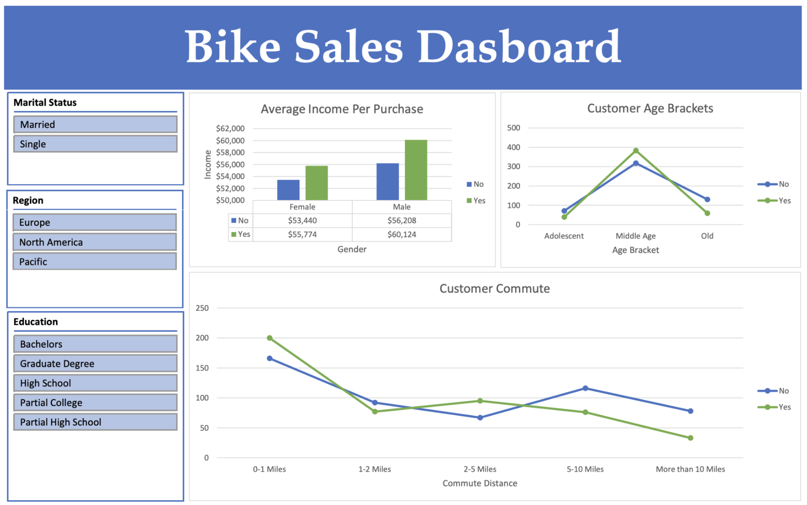

# Bike Sales Analysis & Interactive Dashboard

### Project Overview

This project explores customer purchasing behavior using a bike sales dataset containing demographic and lifestyle information for 1,000 customers.

The objective is to identify trends and patterns associated with bike purchasing decisions by analyzing customer income, age, gender, commute distance, education, region, and marital status.

Microsoft Excel was used to clean and analyze the data, create PivotTables and visualizations, and develop an interactive dashboard.

## Tools & Skills
- Microsoft Excel
- Data Cleaning
- PivotTables
- Data Visualization
- Interactive Dashboards
- Excel Slicers
- Data Analysis

# Project Workflow
1. Imported and explored the raw dataset.
2. Removed duplicate records and standardized categorical values.
3. Created age brackets using Excel IF statements.
4. Created PivotTables to analyze customer purchasing behavior.
5. Developed visualizations to identify trends.
6. Built an interactive dashboard with slicers for education, region, and marital status.

## Key Findings
- Customers who purchased bikes had a higher average income than non-purchasers.
- Middle-aged customers had the highest bike purchase rate.
- Customers commuting 0–1 miles had the highest purchase rate.
- Customers commuting more than 10 miles had the lowest purchase rate.

## Dashboard Preview

## Project Files
- `data/` — Original dataset
- `excel/` — Excel workbook containing the analysis and interactive dashboard
- `presentation/` — Project presentation in PowerPoint and PDF formats
- `images/` — Dashboard screenshot

## Author

Jessica Makar 

Computer Science & Data Science | Rutgers University